# Remote Work Simulator

**Get paid. Do nothing. Don't get caught.**

A first-person comedy stealth/management sim for PC. You are a remote employee of SynerCorp, a
dysfunctional software company. You are paid to work from home. Your goal is to
survive one working week, Monday to Friday, without doing any actual work, while
convincing your manager Martin that you are the most productive person on the team.

In Remote Work Simulator, productivity is the enemy.

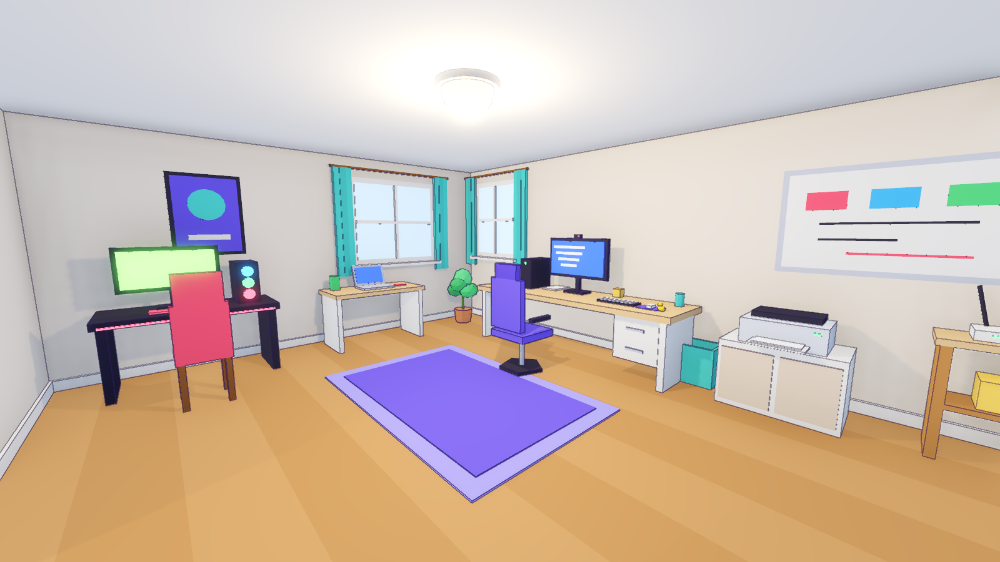

| | |
| --- | --- |
| 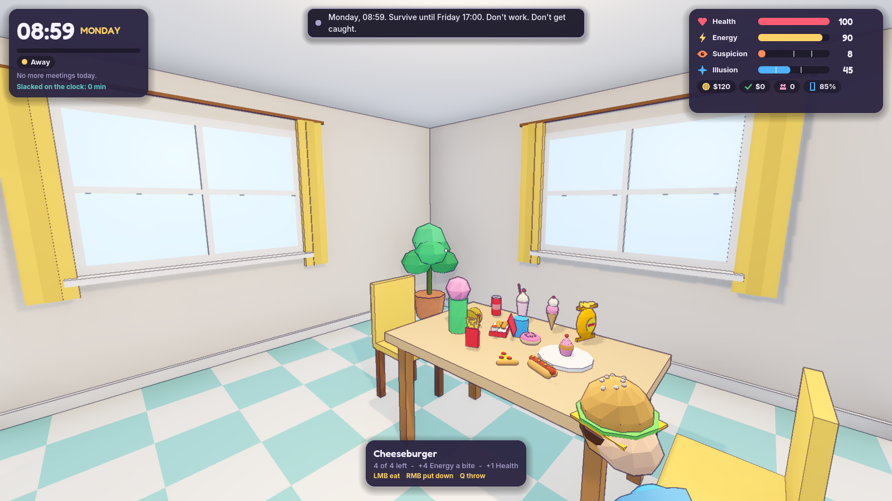 | 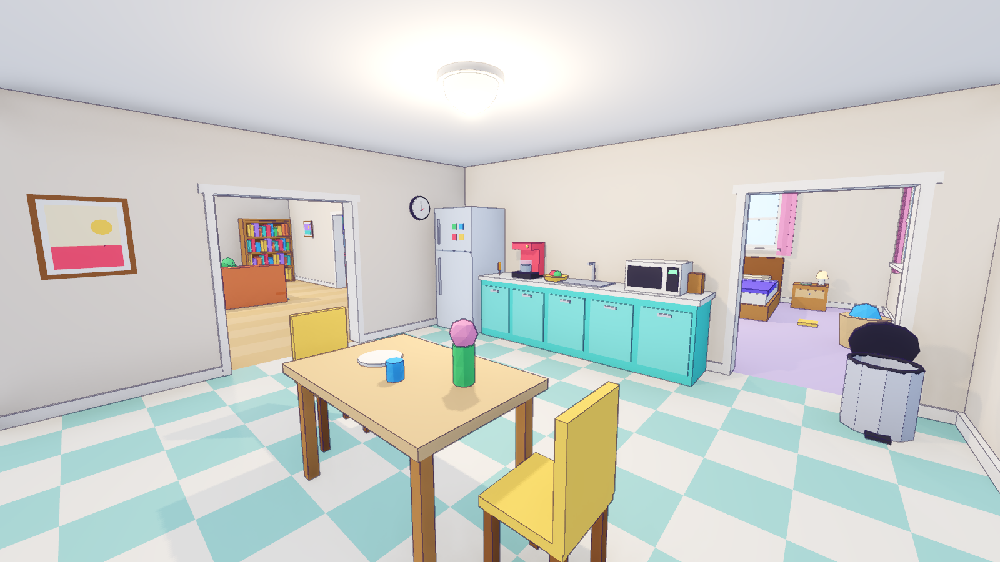 |
| 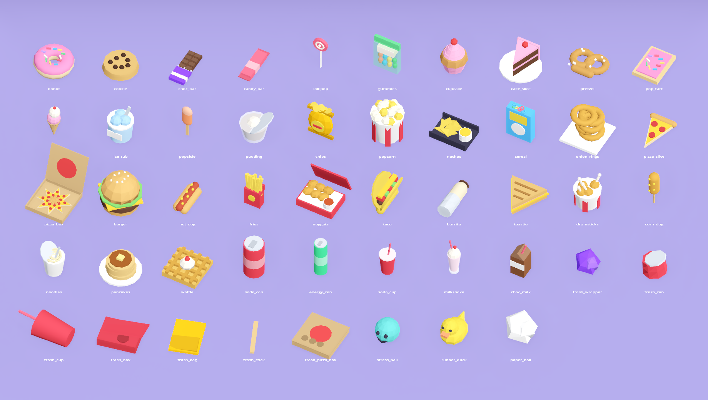 | 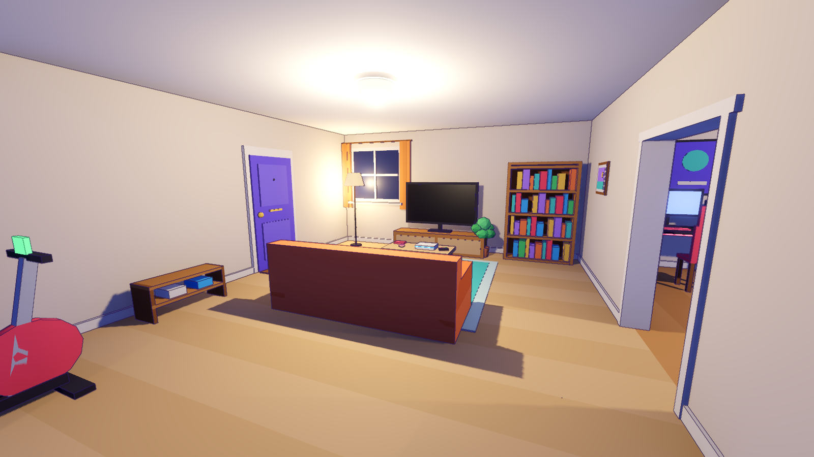 |
| 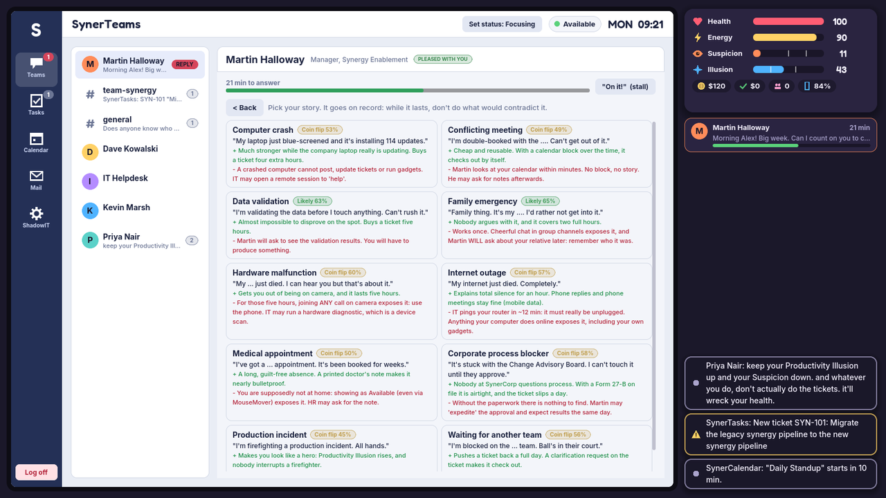 | 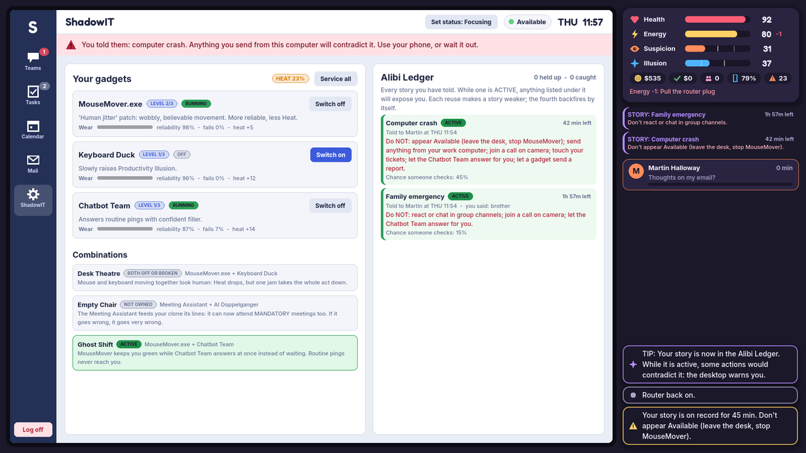 |
| 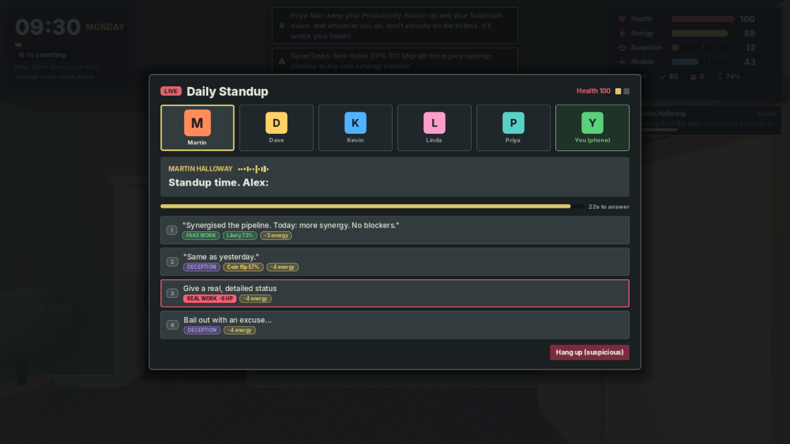 | 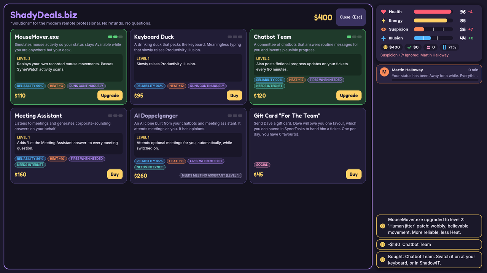 |
| 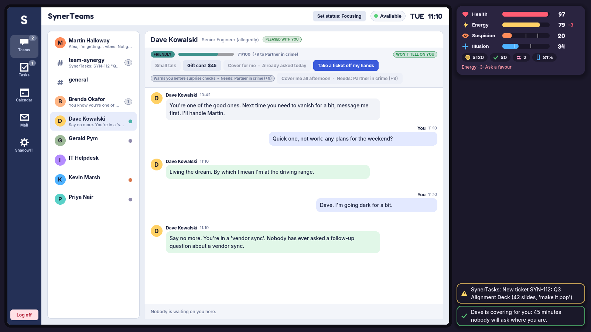 | 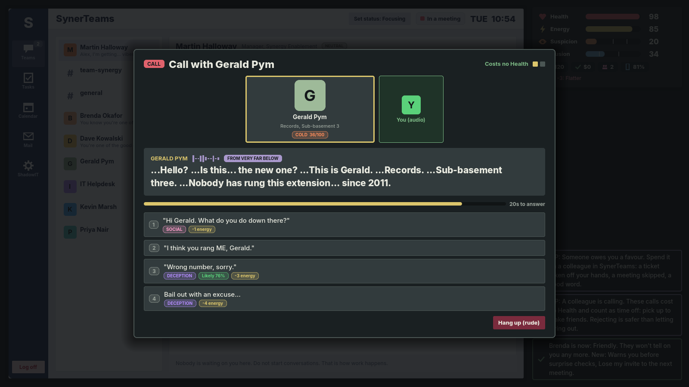 |

This repository is the playable vertical slice: one apartment, one week, four
difficulties, 20 to 40 minutes per run.

- Engine: Godot 4.7 (Forward+), typed GDScript only
- Platforms: Linux and Windows
- First person, in a flat seen from the inside: cartoon colours, chunky low-poly
  furniture and an ink outline on everything
- No imported art or audio: every mesh, icon and sound is generated in code

## Run it

```bash
tools/setup_godot.sh   # once: downloads the pinned Godot 4.7.2 into .tools/ and verifies its checksum
./run.sh               # play
```

`./run.sh` uses `.tools/godot` if present, otherwise `godot4`/`godot` from your
PATH, or `GODOT=/path/to/godot ./run.sh`.

To open the project in the editor:

```bash
.tools/godot --path . --editor
```

## How to play

| Key | Action |
| --- | --- |
| Mouse | Look around |
| W A S D / arrows | Walk (Shift to hurry) |
| E or left click | Use what the crosshair is on / pick it up / stop the current activity |
| Left click | Eat, drink or squeeze what you are holding |
| Right click | Put it down where you are looking |
| Q | Throw it |
| 1 to 9 | Pick an option or an answer |
| Tab | Phone: answer chats and calls from anywhere |
| Alt (hold) | Free the mouse pointer to click things on screen |
| Esc | Leave the desk / close / pause |

Mouse sensitivity, field of view, head bob and the ink outlines are in Settings.

The workday runs 09:00 to 17:00. Four resources decide whether you make it:

- **Health** is destroyed by real work, and worn down by meetings and long
  stretches at the desk. Leisure, food and sleep restore it. At 0 you burn out.
- **Energy** is spent on every lie, fake update and excuse. Eat, drink coffee, nap.
- **Suspicion** rises when you are visibly absent, ignore messages, miss meetings
  or get caught lying. At 100 you are fired.
- **Productivity Illusion** is how busy you look. Above 60 it drains Suspicion;
  below 25 it feeds it.

Anything tagged **REAL WORK** in red costs Health. Everything else is fair game:
fake it, delegate it, excuse it, automate it, or bury it in paperwork.

**Every lie is remembered.** Tell Martin your internet is down, then join a
meeting on camera, and he will ask about it. The Alibi Ledger (ShadowIT, on the
work computer) lists every story you have told and what would expose it.

**Colleagues** call and message you. Leave one hanging and they may tell
Martin; pick up, cover for them and listen, and they become friends who take
your tickets, cover your absences and warn you before he checks on you. Each
has a story told in calls over the week, and each has a voice. From Tuesday,
so do the unknown numbers: a robocall about your chair's warranty, somebody's
grandmother, a fax machine.

**Junk food** turns up around the flat every morning: 38 kinds, from a glazed
donut to a bucket of drumsticks. Pick something up, carry it to the sofa or the
desk, and eat it a bite at a time for Energy without leaving your chair. Your
stomach has a limit, the microwave makes hot things better, the fridge hands
out cold ones, and what is left (wrappers, cans, boxes) has to go in a bin or
you wake up in it. A pizza can be ordered from the Gaming PC.

**Gadgets** keep you looking present while you are not: MouseMover.exe, the
Keyboard Duck, Chatbot Team, the Meeting Assistant and the AI Doppelganger, each
with three levels, a reliability, and its own way of going wrong.

Surviving the week is a pass. Your **grade** is the paid time you spent slacking:
leisure taken between 09:00 and 17:00. Standing still is not a strategy: an idle
player is fired on Monday on every difficulty.

| Difficulty | Suspicion | Work costs | Notes |
| --- | --- | --- | --- |
| Intern | x0.6 | 2 HP | Forgiving boss, long reaction windows, generous recovery |
| Corporate Survivor | x1.0 | 8 HP | The intended experience |
| Senior Bullshitter | x1.7 | 20 HP | Frequent checks, unreliable gadgets |
| Professional Unemployed | x1.5 | run over | Any legitimate work action ends the run |

The systems are described in [docs/GAME_DESIGN.md](docs/GAME_DESIGN.md).

## Validate and test

```bash
tools/validate.sh      # headless validation: compile, boot the main scene, load every
                       # scene and resource, check every gameplay invariant
tools/test.sh          # everything: the above plus full-week runs and the 3D world walk
```

`tools/validate.sh` is the checked equivalent of `godot --headless --path . --quit`.
A clean exit code alone proves little, so it also fails on any error or warning
in the startup log and on any failed invariant.

What the tests cover:

- `tests/rules_test`: content integrity (every id referenced by every resource
  exists), stat clamping, work penalties per difficulty, the Extreme-mode
  instant defeat for every legitimate work action, claim creation, expiry and
  contradiction for all ten categories, gadget activation, upgrades, failures
  and combinations, event preconditions, pacing and modal conflicts, NPC state,
  colleagues (friendship tiers, telling on you, every favour, every scripted
  and strange call played to the end three ways), junk food (every kind has a
  model of its own, bites, fullness, leftovers, the bin, the fridge, the
  microwave, pizza), the economy, and a save/load round trip.
- `tests/run_test`: bots (idle, honest worker, skilled slacker, and a slacker
  who ignores every colleague) play whole weeks with invariants checked every
  simulated minute. It fails if a run softlocks, if standing still can win, if
  an honest worker can win Extreme, if skilled avoidance stops being viable,
  or if ignoring colleagues stops costing more than befriending them.
- `tests/world_test`: builds the real apartment and walks the player to every
  object with physics and collisions on; checks that the crosshair finds each
  one, that the flat is closed with open doorways, that every seat puts your
  eyes somewhere sensible, and that items can be picked up, eaten, put down,
  thrown and binned.
- `tools/shots.sh <scene>` renders scripted screenshots offscreen (needs `xvfb`);
  `tools/shots.sh autoplay` has a bot play a week through the real UI.
  `tests/harness/food_sheet.tscn` renders every junk-food model on one sheet.

Useful while balancing:

```bash
.tools/godot --headless --path . res://tests/run_test.tscn -- --trace=slacker/senior --runs=30
```

prints win rate, per-day averages, where every point of Suspicion came from,
how each claim ended and which events fired.

## Project layout

```
scenes/              one folder per area: main_menu, apartment, player, workstation, ui, events
scripts/core/        GameManager, TimeManager, PlayerStats, EconomyManager, SaveManager
scripts/simulation/  WorkSystem, Comms, Home, Presence, Activities
scripts/deception/   DeceptionManager and the Claim model
scripts/automation/  AutomationManager
scripts/events/      EventDirector, Dialogue, Tutorial
scripts/npcs/        NPCManager, Social (colleagues)
scripts/apartment/   World, Apartment, Interactable, Holdable, Kit, FoodKit
scripts/player/      Player (first person), Character (the body in the menus)
scripts/data/        Resource classes for authored content
scripts/ui/          HUD, the SynerOS desktop, dialogs and menus
resources/           all content as Godot Resources: events, dialogue, gadgets,
                     npcs, deception, tasks, balancing, text
assets/              generated audio, fonts
tests/  tools/  docs/
```

See [docs/ARCHITECTURE.md](docs/ARCHITECTURE.md) for how the pieces fit together
and how to add events, gadgets, excuses and characters as data.

## Building

`export_presets.cfg` has Linux and Windows presets. Install the Godot 4.7.2
export templates (Editor > Manage Export Templates), then:

```bash
godot --headless --path . --export-release "Linux" build/linux/RemoteWorkSimulator.x86_64
godot --headless --path . --export-release "Windows" build/windows/RemoteWorkSimulator.exe
```

Steam integration (achievements, cloud saves, overlay) is not part of this slice.

## Licences

Code is under the licence in [LICENSE](LICENSE). Third-party material and its
terms are tracked in [docs/CREDITS.md](docs/CREDITS.md): two fonts under the SIL
Open Font License, and the Godot engine. Everything else is original.
