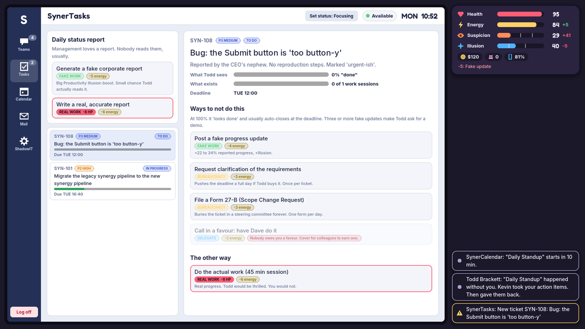
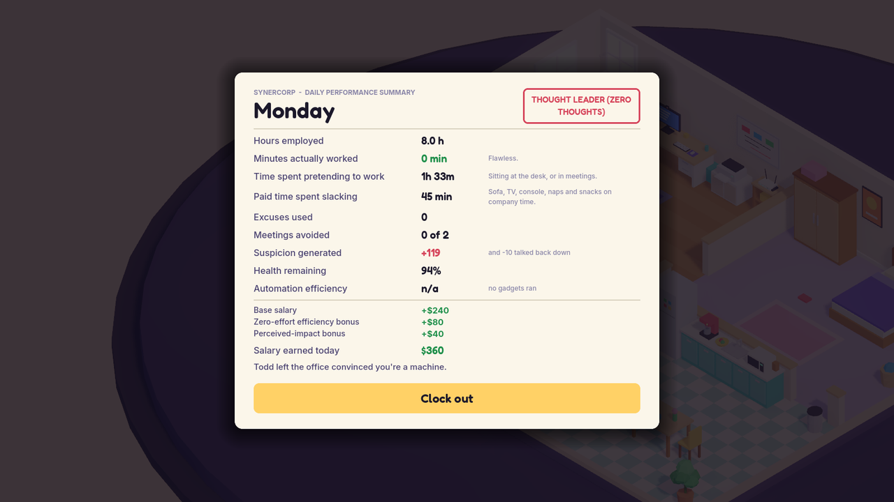

# Remote Work Simulator

**Get paid. Do nothing. Don't get caught.**

A comedy stealth/management sim for PC. You are a remote employee of SynerCorp, a
dysfunctional software company. You are paid to work from home. Your goal is to
survive one working week, Monday to Friday, without doing any actual work, while
convincing your boss that you are the most productive person on the team.


| | |
| --- | --- |
|  |  |
|  |  |

This repository is the playable vertical slice: one apartment, one week, four
difficulties, 20 to 40 minutes per run.

- Engine: Godot 4.7 (Forward+), GDScript only
- Platforms: Linux and Windows
- No imported art or audio: every mesh, icon and sound is generated in code

## Run it

```bash
tools/setup_godot.sh   # once: downloads the pinned Godot 4.7.2 into .tools/ and verifies its checksum
./run.sh               # play
```

Or open the folder in the Godot 4.7 editor and press F5. `./run.sh` uses `.tools/godot`
if present, otherwise `godot4`/`godot` from your PATH, or `GODOT=/path/to/godot ./run.sh`.

## How to play

| Key | Action |
| --- | --- |
| W A S D / arrows | Walk |
| Left click | Walk to a spot, or walk to an object and use it |
| F or Space | Use the highlighted object / stop the current activity |
| 1 to 9 | Pick an option or an answer |
| Tab | Phone: answer chats and calls from anywhere |
| Q / E | Rotate the camera 90 degrees |
| Mouse wheel | Zoom |
| Esc | Leave the desk / close / pause |

The workday runs 09:00 to 17:00. Four resources decide whether you make it:

- **Health** is destroyed by real work, and worn down by meetings and long stretches
  at the desk. Leisure, food and sleep restore it. At 0 you burn out.
- **Energy** is spent on every lie, fake update and excuse. Eat, drink coffee, nap.
- **Suspicion** rises when you are visibly absent, ignore messages, miss meetings
  or get caught lying. At 100 you are fired.
- **Productivity Illusion** is how busy you look. Above 60 it drains Suspicion;
  below 25 it feeds it.

Surviving the week is a pass. Your **grade** is the paid time you spent slacking:
leisure taken between 09:00 and 17:00 (the clock card counts it for you).

Anything tagged **REAL WORK** in red costs Health. Everything else is fair game:
fake it, delegate it, excuse it, automate it, or bury it in paperwork. Standing
still is not a strategy: an idle player is fired on Monday on every difficulty
except Intern, where it takes until Tuesday.

| Difficulty | Suspicion | Work costs | Notes |
| --- | --- | --- | --- |
| Intern | x0.6 | 2 HP | Forgiving boss, long reaction windows, generous recovery |
| Corporate Survivor | x1.0 | 8 HP | The intended experience |
| Senior Bullshitter | x1.7 | 20 HP | Frequent checks, unreliable gadgets |
| Professional Unemployed | x1.5 | run over | Any legitimate work action ends the run |

A full description of the systems is in [docs/GAME_DESIGN.md](docs/GAME_DESIGN.md).

## Tests

```bash
tools/test.sh          # parse check + rules/balance + 3D world walk
```

- `tests/sim_test` runs headless against the simulation core: content integrity,
  the work classification rules, core rules, save/load round trip, and a balance
  matrix of three bots (idle, honest worker, skilled slacker) on all four
  difficulties. It fails if standing still can ever win, if an honest worker can
  win Professional Unemployed, or if skilled avoidance stops being viable.
- `tests/world_test` builds the real apartment and walks the player to every
  object with physics and collisions on.
- `tools/shots.sh <scene>` renders scripted screenshots offscreen (needs `xvfb`).
  `tools/shots.sh autoplay` has a bot play a week through the real UI.

Useful while balancing:

```bash
.tools/godot --headless --path . res://tests/sim_test.tscn -- --trace=slacker/senior --runs=30
```

prints win rate, per-day averages and where every point of Suspicion came from.

## Project layout

```
scripts/core/     simulation: no scenes, no UI, fully headless-testable (autoloads)
scripts/world/    the 3D apartment, character, player, camera, lighting
scripts/ui/       HUD, SynerOS desktop and its apps, overlays, menus
scripts/dev/      screenshot and autoplay harness (excluded from exports)
assets/audio/     generated by tools/gen_audio.py
assets/fonts/     Fredoka and Inter (SIL Open Font License)
tests/            headless test scenes
tools/            setup, checks, screenshots, audio generation
docs/             architecture and game design
```

See [docs/ARCHITECTURE.md](docs/ARCHITECTURE.md) for how the pieces fit together
and where to add content.

## Building

`export_presets.cfg` has Linux and Windows presets. Install the Godot 4.7.2
export templates (Editor > Manage Export Templates), then:

```bash
godot --headless --path . --export-release "Linux" build/linux/RemoteWorkSimulator.x86_64
godot --headless --path . --export-release "Windows" build/windows/RemoteWorkSimulator.exe
```

Steam integration (achievements, cloud saves, overlay) is not part of this slice.

## Licences

Code is under the licence in [LICENSE](LICENSE). Fonts are under the SIL Open Font
License (see `assets/fonts/*-OFL.txt`). Audio is generated by `tools/gen_audio.py`
and carries no third-party rights.
